# TF2Tools

Set up your Team Fortress 2 HUD, hitsounds, killsounds, crosshairs and graphics in a few clicks, and find new ones from the community without leaving the app.

**[Download for Windows](https://github.com/PhongGuy/TF2Tools/releases/latest/download/TF2Tools.exe)** · **[Download for Linux](https://github.com/PhongGuy/TF2Tools/releases/latest/download/tf2tools-linux-x86_64.AppImage)**

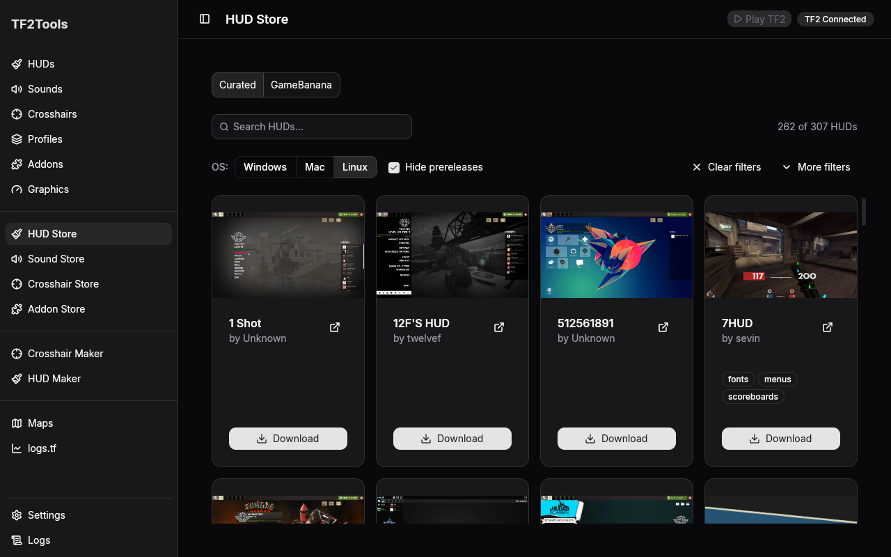

TF2Tools is free and open source. It finds your game through Steam, puts what you pick into TF2's custom folder for you, and keeps everything you collect in one library, so switching back is one click.

This is TF2Tools 6, a native desktop app rebuilt from the ground up. It replaces the older TF2Tools, which ran inside a web browser engine; the new one is a regular app, lighter and quicker to use. The older app still lives on the [v4 branch](https://github.com/PhongGuy/TF2Tools/tree/v4), and its downloads are in the releases up to v4.8.0.

## What it does

### HUDs

Keep all your HUDs in one place and switch between them with one click. TF2 can only use one HUD at a time, so TF2Tools takes the old one out when you install another. If a HUD needs fonts you don't have, TF2Tools offers to install them. Get new HUDs from the HUD Store: the hand-picked list from hud-db, or everything on GameBanana. When a newer version of a HUD you got from the HUD Store is out, its card shows **Update**. If it has several files on GameBanana, you pick which one.

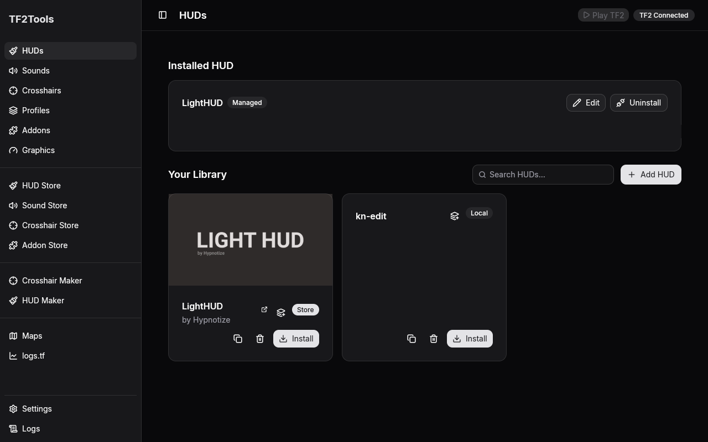

### Hitsounds and killsounds

Add your own sounds or download them from the Sound Store, play them right in the app, and pick one as your hitsound and one as your killsound.

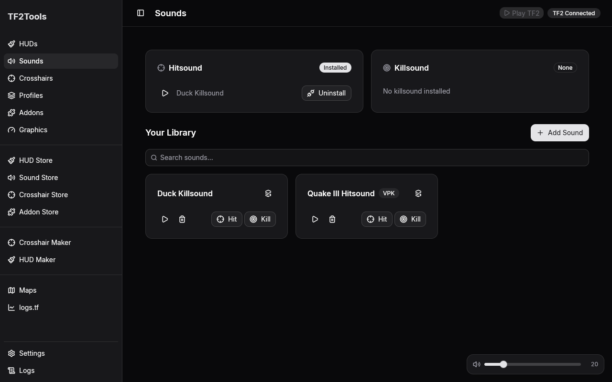

### A crosshair for every weapon

Go class by class and give each weapon its own crosshair: one of TF2's own, an image of your own, or one from the Crosshair Store.

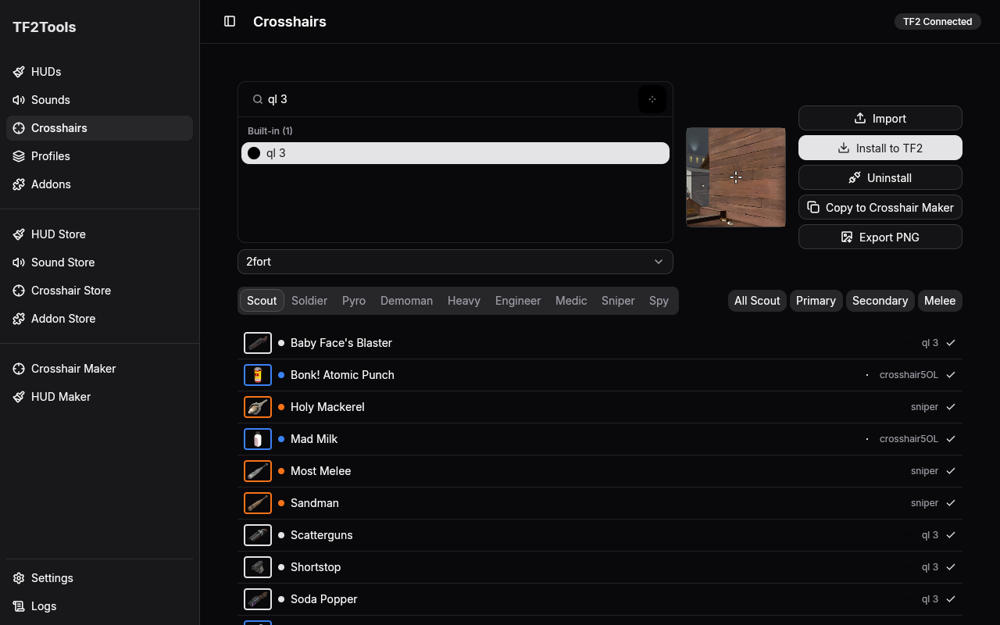

### mastercomfig addons

Install mastercomfig's addons from the Addon Store. The Addons page shows what you have and offers updates when mastercomfig releases new ones.

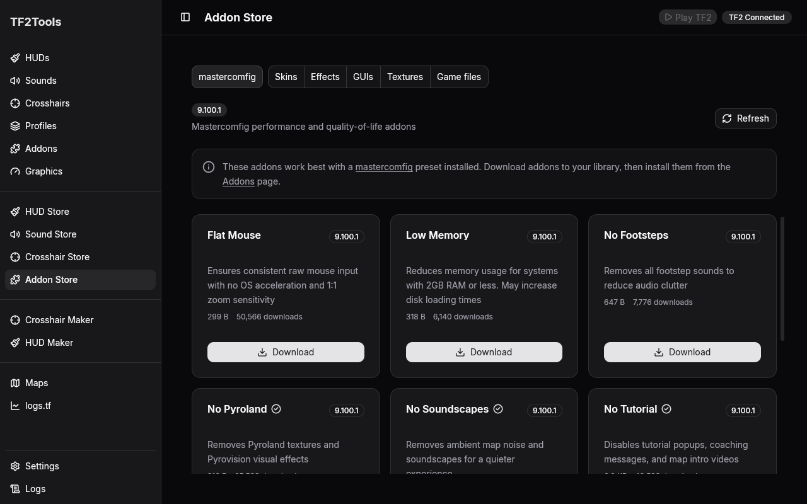

### Graphics

The Graphics page sets TF2's graphics with mastercomfig. Install mastercomfig in one click, update it when a new version is out, or let TF2Tools take over the copy you already have. Pick a graphics preset, from Ultra down to Low, then change any of its settings one by one, or reset them to the preset. Changes apply the next time TF2 starts.

### The stores

Browse sounds and crosshairs from GameBanana, preview sounds before you download them, search and sort the GameBanana stores, and filter the hand-picked HUDs. Next to its mastercomfig tab, the Addon Store has GameBanana tabs for skins, effects, GUIs, textures and game files. Install one from its details; if a download holds several versions, you pick which to install. TF2Tools checks your add-ons for updates once a day, and the Addons page lists them with Update and Remove. Files that failed GameBanana's virus scan, or are only a program, are refused, and add-ons are never changed while TF2 is running.

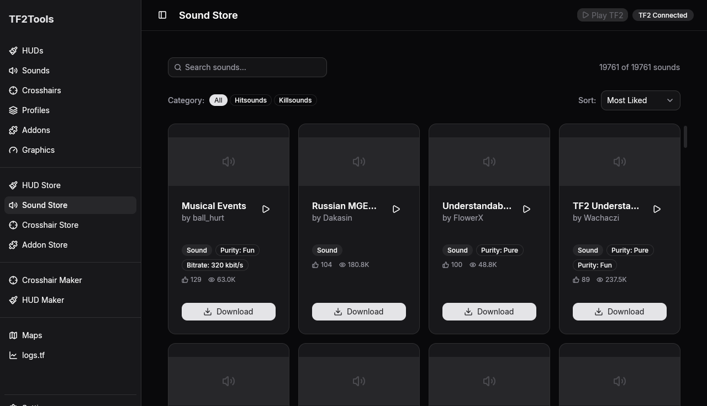

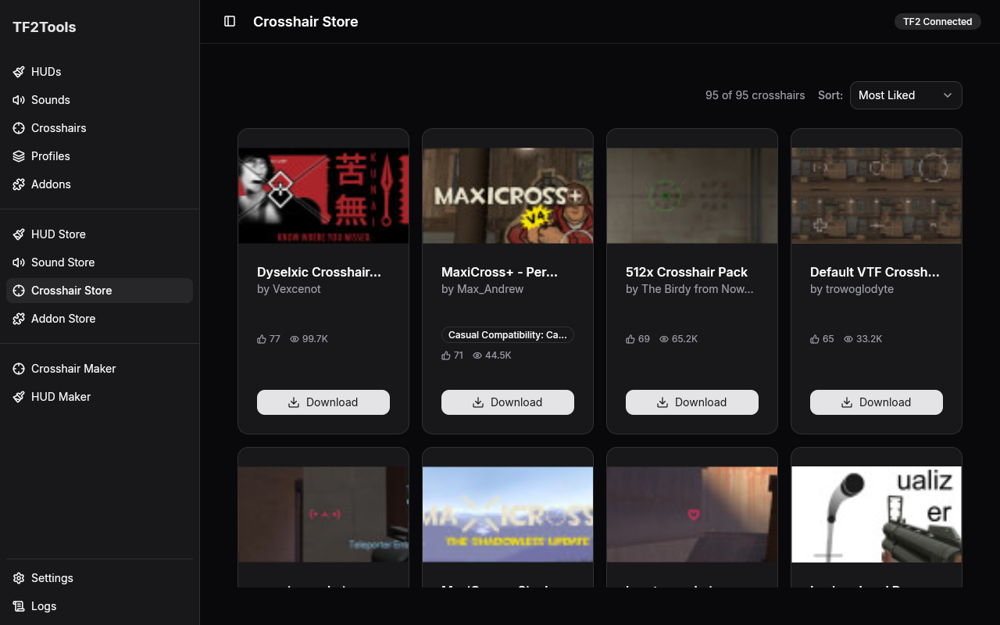

### Make your own crosshair

The Crosshair Maker lets you draw a crosshair pixel by pixel. Start from a shape such as a dot, a cross or a circle, or bring in a picture, then shape it with the pencil, lines, boxes and circles. The preview shows it over a map as you work. Save it, and it joins your crosshairs, ready to give to any weapon.

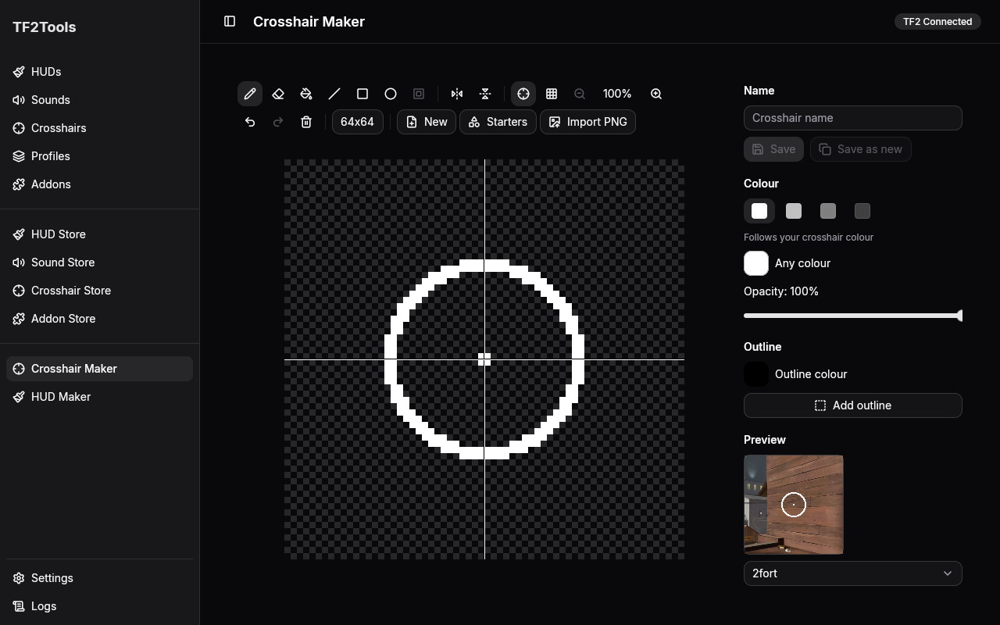

### Make your own HUD

The HUD Maker shows your HUD the way the game draws it: in a fight, on the scoreboard, at the main menu and more. Click any part to move it, resize it, recolour it or hide it, or start from one of your HUDs with **Edit a copy**. Save it to your library and install it like any other HUD.

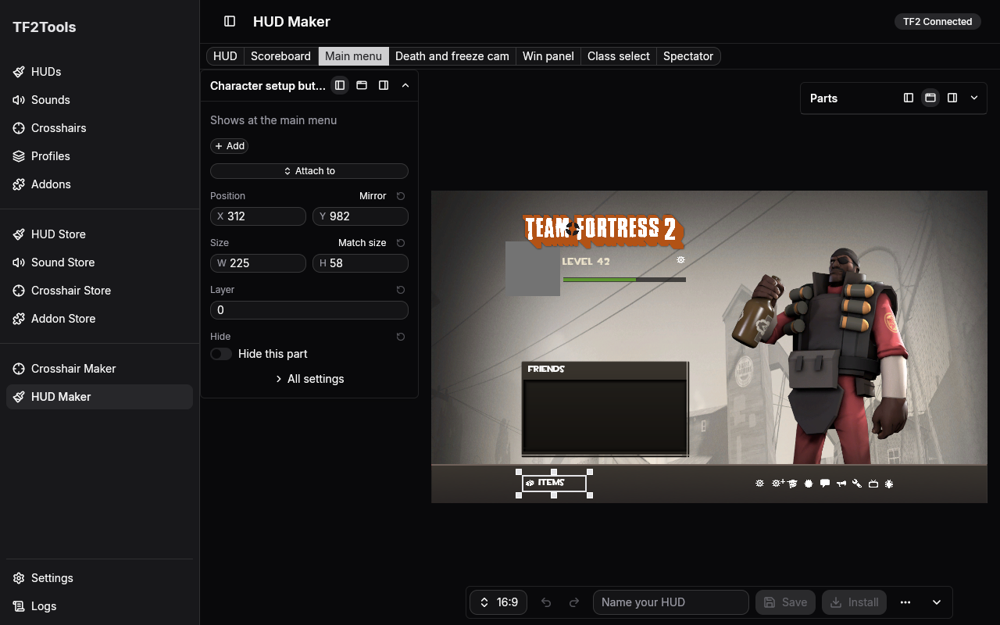

### Maps

The Maps page lists the community maps from serveme.tf. Search them by name, sort them by name, by most played or by recently played, and download a map straight into your game. Remove a map you downloaded when you no longer need it.

Switch the page to GameBanana to browse the TF2 maps there. Search them, sort them and pick a gamemode such as King of the Hill, Payload or Mann vs. Machine. Open a map to see its pictures and downloads, with a link to its GameBanana page. Installing GameBanana maps from the app is not there yet.

### logs.tf stats

The logs.tf page shows your competitive stats from logs.tf. Paste your Steam profile link or Steam ID to track yourself, and add teammates the same way. Each player gets a card per class with their averages, and below it a list of their logs. Each log shows when the match started and your own kills, assists, deaths, damage and damage taken in it. Click a class someone played to see their weapons for it: kills, damage and accuracy for each one. Weapons go by their in-game names, read from your TF2 install when TF2Tools finds it. Each weapon shows its kill feed icon, also read from your TF2 install. Drag the range slider to look at only your most recent logs. Open a log to see it the way logs.tf shows it: the players, the kills between classes, the rounds and the events. Give a player a nickname when you add them, or with the pencil beside their name, and opened logs call them by it; you can turn that off in Settings. TF2Tools downloads your logs once and keeps them, so the page works offline, and a download that stopped picks up where it left off.

### Profiles

Save your HUD, sounds and crosshairs together as a profile, for example one for competitive and one for casual, and switch your whole setup at once.

You can also add a HUD or a sound to a profile from its card with **Add to profile**, or send the selected crosshair to a profile from the Crosshairs page and pick its weapons there.

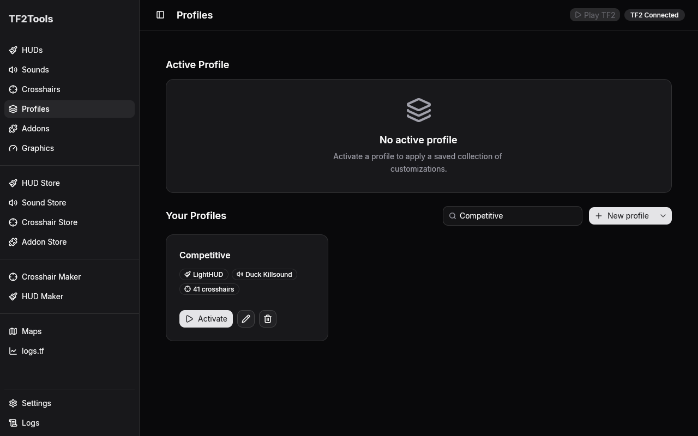

### Settings

Point TF2Tools at your game if it didn't find it, set the preview volume and refresh the stores. The Activity Log (**Logs** in the sidebar) lists what TF2Tools did, and TF2Tools checks for new versions of itself (see [Updates](#updates)).

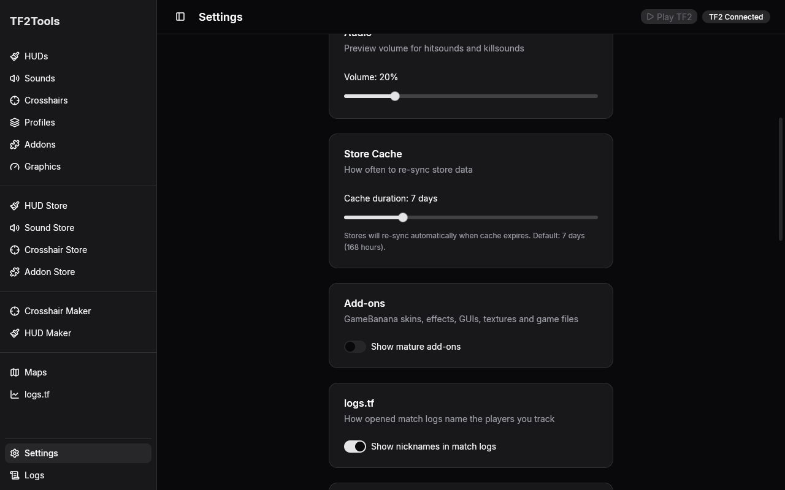

## Download and install

The download links on this page always fetch the newest TF2Tools for Windows or Linux. Older versions, TF2Tools 4 among them, stay on the [Releases page](https://github.com/PhongGuy/TF2Tools/releases).

### Windows

1. Download **[TF2Tools.exe](https://github.com/PhongGuy/TF2Tools/releases/latest/download/TF2Tools.exe)** and open it.
2. Windows may say **"Windows protected your PC"**, because TF2Tools isn't signed with a paid certificate. Click **More info**, then **Run anyway**.
3. The installer sets TF2Tools up for your Windows account. It doesn't ask for an administrator password.
4. Start TF2Tools from the Start menu or the desktop shortcut.

### Linux

Download one of these:

- **Ubuntu, Debian, Mint and similar:** **[tf2tools-linux-amd64.deb](https://github.com/PhongGuy/TF2Tools/releases/latest/download/tf2tools-linux-amd64.deb)**. Double-click it to open it in your software center, then click Install. TF2Tools appears in your app menu.
- **Any other distribution:** **[tf2tools-linux-x86_64.AppImage](https://github.com/PhongGuy/TF2Tools/releases/latest/download/tf2tools-linux-x86_64.AppImage)**. Right-click it, open Properties, allow it to run as a program, then double-click it. If it doesn't start, your system may be missing FUSE, which AppImages use; your distribution's help pages explain how to add it.

TF2Tools is built on Ubuntu 22.04, so it runs on that and newer systems.

### First start

TF2Tools looks for Team Fortress 2 in your Steam libraries. The badge at the top says **TF2 Connected** when it found the game. If it says **TF2 Not Found**, open **Settings**, click **Auto-detect** or **Browse** to your Team Fortress 2 folder, then **Save Settings**.

### Updates

TF2Tools tells you when a new version is out. On Windows and with the AppImage it updates itself in one click. With the `.deb`, it opens the release page so you can download the new one the same way.

## Quick start

1. Install TF2Tools and open it. Check that the badge at the top says **TF2 Connected**.
2. Open the **HUD Store**, pick a HUD and download it. It lands in **HUDs**, your library.
3. On the **HUDs** page, click **Install** on the HUD you want. Start TF2 and it's there.
4. Do the same for sounds in the **Sound Store** and **Sounds**, and give your weapons crosshairs on the **Crosshairs** page.
5. Happy with your setup? Save it as a profile on the **Profiles** page so you can switch back in one click.

TF2 reads its HUD, sounds and crosshairs when it starts, so restart the game to see a change.

## Coming from an older version

- **TF2Tools 5:** your library, profiles and settings carry over. TF2Tools 6 uses the same library and upgrades it the first time it opens.
- **TF2Tools 4:** TF2Tools 6 starts with an empty library, since it can't read TF2Tools 4's list. What TF2Tools 4 put in your game stays there until you replace it, and installing a HUD from TF2Tools 6 takes out the HUD you have now. On Windows, TF2Tools 6 installs next to TF2Tools 4 and takes over the desktop shortcut. Once you're happy, remove the old one in Windows **Settings > Apps > Installed apps**: it's the TF2Tools entry with version 4.8.0.
- **Still want TF2Tools 4?** Its downloads stay on the [Releases page](https://github.com/PhongGuy/TF2Tools/releases) up to v4.8.0, and its code is on the [v4 branch](https://github.com/PhongGuy/TF2Tools/tree/v4).

## Privacy

No accounts, no ads, no tracking. TF2Tools goes online for the stores (GameBanana, GitHub and mastercomfig.com), for the Maps page (serveme.tf and GameBanana), for the logs.tf page (logs.tf, and Steam to look up a profile link) and to check GitHub for a new version of TF2Tools. Your library stays on your computer. The weapon icons in the crosshair list come from your own TF2 install.

## License

MIT, see [LICENSE](LICENSE). The bundled Inter font is under the SIL Open Font License, in `licenses/Inter-OFL.txt`. The icons come from Lucide and are under the ISC License, in `licenses/Lucide-ISC.txt`. The app carries these notices, and the ones below, inside itself and shows them under Settings, Licences.

### Where the content comes from

- **mastercomfig:** the addons in the Addon Store come from [mastercomfig](https://mastercomfig.com), Copyright (c) 2016-2026 mastercoms, under the MIT License, in `licenses/mastercomfig-MIT.txt`. TF2Tools is not made, sponsored, endorsed or licensed by, or affiliated with mastercomfig.
- **hud-db:** the hand-picked HUD list in the HUD Store comes from [hud-db](https://github.com/mastercomfig/hud-db), Copyright (c) 2024-2026 mastercomfig, under the MIT License, in `licenses/hud-db-MIT.txt`. Each HUD belongs to its authors.
- **GameBanana:** the HUDs, sounds, crosshairs and other items in the GameBanana stores come from [GameBanana](https://gamebanana.com), owned and run by GameBanana Co LLC. Each item belongs to the creators credited on its GameBanana page, and TF2Tools claims no rights to it. TF2Tools is not made, sponsored, endorsed or licensed by, or affiliated with GameBanana or GameBanana Co LLC.
- **serveme.tf:** the community map list on the Maps page, and its map files, come from [serveme.tf](https://serveme.tf). Each map belongs to its makers. TF2Tools is not made, sponsored, endorsed or licensed by, or affiliated with serveme.tf.
- **logs.tf:** the stats and logs on the logs.tf page come from [logs.tf](https://logs.tf). TF2Tools is not made, sponsored, endorsed or licensed by, or affiliated with logs.tf.

### Valve

Team Fortress 2, its weapon icons, crosshairs and other game artwork are the property of Valve Corporation. TF2Tools uses them with credit, in a free fan tool for players of the game. The weapon icons in the crosshair list are read from your own TF2 install.

Valve, the Valve logo, Steam, the Steam logo, Team Fortress and the Team Fortress logo are trademarks and/or registered trademarks of Valve Corporation in the U.S. and/or other countries. All other trademarks are property of their respective owners.

TF2Tools is not made, sponsored, endorsed or licensed by, or affiliated with Valve Corporation.

## For developers

TF2Tools 6 is written in Rust with [GPUI](https://www.gpui.rs/), the UI framework behind the Zed editor. There is no web view: `crates/tf2tools-core` holds the library, installs, file formats and store clients without any UI, and `crates/tf2tools-app` is the app.

To build and try it from source you need Rust 1.99 or newer, and on Linux the system libraries listed in [CONTRIBUTING.md](CONTRIBUTING.md#requirements). Then:

```bash
git clone https://github.com/PhongGuy/TF2Tools.git
cd TF2Tools
make demo     # runs against a throwaway library and a fake TF2 install
make check    # formatting, lints and the tests
```

`cargo run -p tf2tools-app` runs it against your real library and game instead. Building, testing, packaging and the screenshot script are all in [CONTRIBUTING.md](CONTRIBUTING.md).
